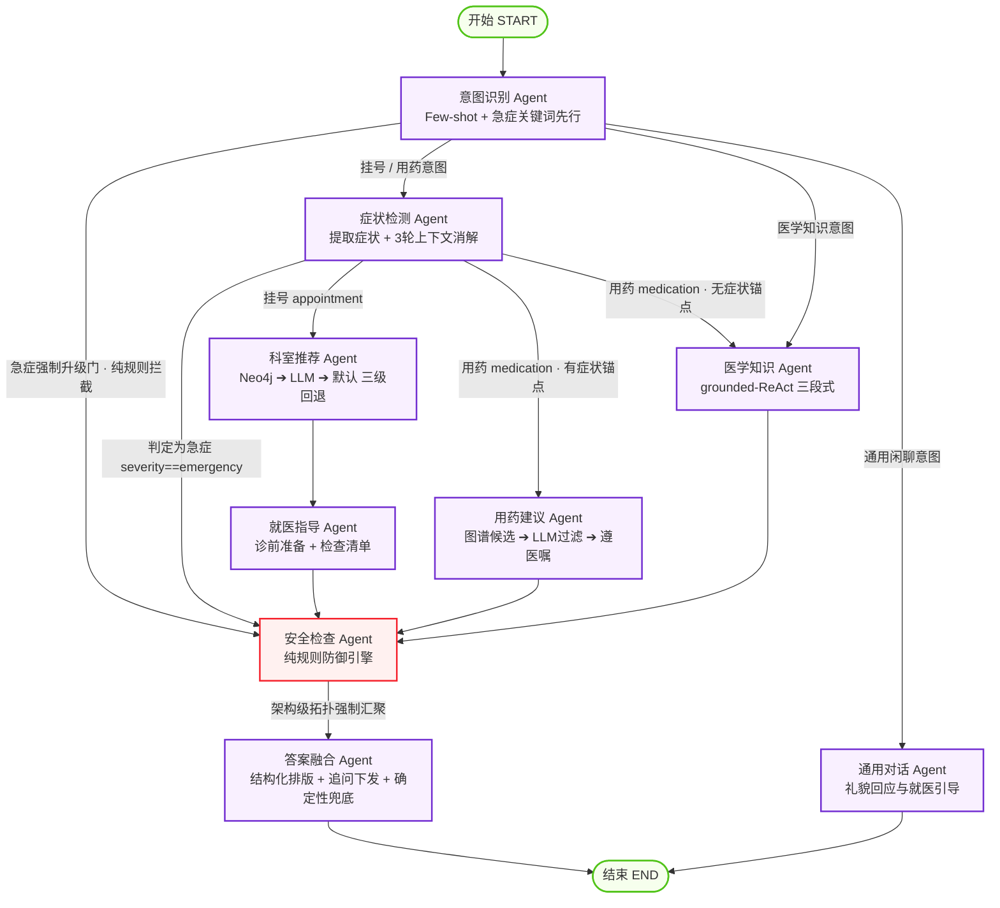
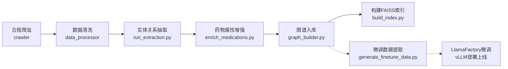

# 🏥 SmartMedicalConsultation 智慧问诊 Agent 系统

<div align="center">

[](https://www.python.org/)
[](https://fastapi.tiangolo.com/)
[](https://github.com/langchain-ai/langgraph)
[](https://neo4j.com/)
[](https://github.com/facebookresearch/faiss)
[](https://huggingface.co/BAAI/bge-m3)
[](https://vuejs.org/)
[](LICENSE)
[](evals/runner.py)

**面向就医前咨询与智能导诊场景的工业级中文医疗问答 Agent 系统**  
*基于 LangGraph 9-Agent 受控状态机 · GraphRAG 混合检索与实体链接 · 纯规则医疗安全底线 · Redis+MySQL 冷热分层记忆*

[English](#) · [功能特性](#-功能特性) · [系统架构](#-系统架构) · [六大工业级亮点](#-六大工业级工程设计亮点) · [快速启动](#-快速启动) · [接口规范](#-api-规范与通信协议) · [评测指标](#-自动化评测与实测表现) · [文档导航](#-项目文档导航)

</div>

---

## 📌 项目定位与核心愿景

在严肃的医疗就医前（Pre-hospital）咨询场景中，普通大模型问答通常面临三大行业痛点：
1. **拓扑关系缺失与事实幻觉**：纯向量检索（Vector RAG）无法理解“疾病-症状-科室-药物-禁忌”之间的复杂多跳拓扑，易产生致命编造；
2. **安全失控与监管悖论**：依赖 LLM 自查安全极不稳定，“让大模型看守大模型”在急危重症和用药禁忌下存在漏判风险；
3. **工程受控性弱与上下文黑盒**：传统自主漫游式 Agent（如 CrewAI/AutoGen）流转不可控、难以复盘排障，无法满足医疗审计需求。

**SmartMedicalConsultation** 采用 **LangGraph** 构建 9-Agent 受控状态机，融合 **Neo4j 知识图谱** 与 **BGE-M3 + FAISS 稠密向量检索**（GraphRAG 混合检索），坚持“**LLM 是被监管的对象，绝不能由自己看守自己**”的设计哲学，打造包含**纯规则急症强制拦截**、**Text2Cypher 五层只读安全网**、**冷热分层记忆**以及 **TDD R1~R8 契约治理**的生产就绪型医疗咨询系统。

> [!WARNING]
> **医疗免责边界声明**：本项目定位为**学术研究、技术原型与教学演示**用途，旨在提供就诊科室引导、就医前注意事项准备与权威医学知识科普，**不具备临床诊断资格，不替代执业医师面诊、处方或急救服务**。遇有胸痛、呼吸困难等急危重症，请立即前往医院急诊或拨打 120！

---

## 🌟 功能特性

```
                                 ┌─► 智能分诊挂号 (Neo4j拓扑打分 ➔ LLM取舍 ➔ 默认值三级回退)
                                 ├─► 循证用药指引 (知识图谱候选药 ➔ LLM安全过滤 ➔ 遵医嘱强提醒)
用户输入 ──► 意图识别 & 急症先行 ─┼─► 权威医学知识 (grounded-ReAct: 强制检索打底 + 可选多跳 + 0.85实体链接)
                                 ├─► 急症实时升级 (纯规则关键词树短路 ➔ 红色预警 ➔ 顶层引导120)
                                 └─► 通用就医引导 (闲聊温和引导 ➔ 明确功能边界)
```

| 模块 | 功能说明 | 关键设计细节 |
|---|---|---|
| 🏥 **智能分诊挂号** | 根据患者口语化描述提取规范症状，智能推荐就诊科室并生成就诊前准备与检查清单 | **三级回退策略**：`Neo4j 拓扑评分 ➔ LLM 综合裁决 ➔ 全科/内科默认兜底`；支持疾病直查跳过症状提取；信息不足时自动触发精准追问（`needs_clarification`）。 |
| 💊 **循证用药建议** | 针对明确病症提供常用药物通用名、主要功效、不良反应及用药警示 | 基于图谱 `TREATED_BY_MEDICATION` 关系召回；高风险用药场景（药物联用/剂量/禁忌/特殊人群）执行**强制拒答兜底**，绝不臆测。 |
| 📚 **医学知识问答** | 面向大众提供疾病科普、病理机制、预防保健等专业知识解答 | **grounded-ReAct 架构**：Step 1 强制混合检索 ➔ Step 2 受控工具多跳取证 ➔ Step 3 分风险兜底；未命中图谱时明确标注“非知识库内容”。 |
| 🚨 **急症主动拦截** | 监测到危急重症征兆时，毫秒级拉响警报并阻断常规对话 | **纯规则确定性防御**：14 类急症关键词树硬匹配，设置“急症强制升级门”，即便大模型误判意图也强制截断进入红色警报通道。 |
| 💬 **通用引导对话** | 对非医疗问答（问候、天气、闲聊等）给予礼貌响应与就诊指引 | 独立流转分支，直接输出，不附加医疗免责声明，避免“过度防御”影响体验。 |
| 🕘 **会话历史与记忆** | 具备多轮指代消解、历史上下文无缝接续与断点记忆恢复能力 | **Redis（热）+ MySQL（冷）分层架构**：12 轮滑动窗口毫秒级读取，全量记录持久化；接入层支持基于 SHA-256 的 6 小时精确匹配缓存（历史开发环境命中耗时约 0.1s）。 |
| 🖥️ **现代全栈交互** | 单进程托管的 Vue 3 现代化界面，支持 SSE 流式推流与全要素展示 | 实时展示节点执行进度轨迹（`progress` 帧）、打字效果、Markdown 排版、结构化卡片、知识定位标签（`linked_entities`）与历史会话管理。 |

---

## 🏗️ 系统架构

### 3.1 总体分层架构图

```
┌─────────────────────────────────────── 1. 前端交互层 (Client) ───────────────────────────────────────┐
│              Vue 3 + Vite + Element Plus + Pinia (Markdown 渲染 / 知识定位 Tag / 就诊卡片 / 历史栏)        │
└───────────────────────────────────────────────────┬───────────────────────────────────────────────────┘
                                                    │ HTTP / SSE 长连接 (/api/consult/stream)
┌───────────────────────────────────────────────────▼───────────────────────────────────────────────────┐
│                       2. API 网关接入层 (FastAPI + Uvicorn 0.30+)                                     │
│     - 异步并发控制: asyncio.Semaphore 限制并发防下游击穿                                              │
│     - 接入层精确匹配缓存: SHA-256(Query + 历史 + 模型/系统版本) ➔ TTL 6h                              │
│     - 进程启动期预热: preload_retrieval_stack() 解决 Windows C++ DLL 动态加载访问违规崩溃             │
├───────────────────────────────────────────────────────────────────────────────────────────────────────┤
│                     3. LangGraph 运行时问答中枢 (9-Agent 协同受控状态图)                              │
│                                                                                                       │
│                      ┌────────────────────────────────────────┐                                       │
│                      │            意图识别 Agent              │                                       │
│                      │   (Few-shot LLM + 急症词表短路升级)    │                                       │
│                      └────┬───────────┬───────────┬───────┬───┘                                       │
│                           │           │           │       │ (命中急症词/意图)                         │
│               (挂号/用药) │           │ (医学知识) │       └─────────────────────────────┐             │
│              ┌────────────▼───────┐   │           │ (闲聊)                              │             │
│              │    症状检测 Agent   │   │   ┌───────▼───────┐                     ┌───────▼───────┐     │
│              │ (3轮上下文指代消解) │   │   │ 通用对话 Agent│                     │ 安全检查 Agent │     │
│              └───┬────────────┬───┘   │   │ (友好引导就医)│                     │  (纯规则兜底) │     │
│                  │(挂号)      │(用药)  │   └───────┬───────┘                     │  - 强制免责   │     │
│             ┌────▼────┐  ┌────▼────┐  │           │                             │  - 红色急症警告│     │
│             │科室推荐 │  │用药建议 │  │           │                             │  - 特殊人群提醒│     │
│             │ (三级   │  │(图谱候选│  │           │                             └───────┬───────┘     │
│             │  回退)  │  │+LLM过滤)│  │           │                                     │             │
│             └────┬────┘  └────┬────┘  │           │                                     │             │
│             ┌────▼────┐       │       │           │                                     │             │
│             │就医指导 │       │       │           │                                     │             │
│             └────┬────┘       │       │           │                                     │             │
│                  └────────┬───┴───────┘           │                                     │             │
│                           │                       │                                     │             │
│                           │        ┌──────────────▼─────────────┐                       │             │
│                           │        │     医学知识 Agent         │                       │             │
│                           │        │    (grounded-ReAct)        │                       │             │
│                           │        │ 1. 强制 BGE-M3+Neo4j 检索   │                       │             │
│                           │        │ 2. 实体链接 (0.85 阈值)     │                       │             │
│                           │        │ 3. Text2Cypher 五层只读防护 │                       │             │
│                           │        │ 4. 高风险问题拒答兜底       │                       │             │
│                           │        └──────────────┬─────────────┘                       │             │
│                           │                       │                                     │             │
│                           └───────────────────────┼─────────────────────────────────────┘             │
│                                                   ▼                                                   │
│                                           强制汇聚安全检查                                             │
│                                                   │                                                   │
│                                                   ▼                                                   │
│                                            答案融合 Agent                                             │
│                                        (结构化聚合 + 确定性兜底)                                       │
├───────────────────────────────────────────────────┬───────────────────────────────────────────────────┤
│                     4. 存储与多模态检索层         │             5. 离线数据工程与微调闭环             │
│  ┌───────────────────────┐ ┌────────────────────┐ │  ┌─────────────────────────────────────────────┐  │
│  │   Neo4j 图数据库      │ │  FAISS 向量检索    │ │  │ 合规医疗爬虫 (robots.txt 规范)              │  │
│  │ (8类节点, 12类关系,   │ │ (IndexIVFFlat 1024d│ │  ├─────────────────────────────────────────────┤  │
│  │  MERGE 幂等入库)      │ │  BGE-M3 稠密向量)  │ │  │ 实体关系抽取 (云端 JSON / 本地 vLLM 双链路) │  │
│  ├───────────────────────┤ └────────────────────┘ │  ├─────────────────────────────────────────────┤  │
│  │ Redis 7 (热缓存)      │ ┌────────────────────┐ │  │ 药物属性增强 (enrich_medications.py)        │  │
│  │ (12轮滑动窗口, TTL 24h│ │ MySQL 8 (持久化冷库│ │  ├─────────────────────────────────────────────┤  │
│  │  LPUSH + LTRIM)       │ │  唯一事实源, InnoDB│ │  │ 微调数据工厂 (Alpaca 格式 ➔ LlamaFactory)   │  │
│  └───────────────────────┘ └────────────────────┘ │  └─────────────────────────────────────────────┘  │
└───────────────────────────────────────────────────┴───────────────────────────────────────────────────┘
```

### 3.2 运行时问答 DAG 状态机

系统使用 LangGraph 的 `StateGraph` 进行受控状态流转，节点间通过强类型的 `AgentState` 共享黑板状态：



### 3.3 核心技术栈清单

| 分层 | 组件 / 库 | 版本 | 关键选型理由 |
|---|---|---|---|
| **Agent 状态机** | `langgraph` + `langchain-core` | `^1.0.0` | 基于受控有向无环图（DAG），提供强类型共享 State、显式条件分支与流式生命周期事件 |
| **知识图谱** | `neo4j` (Docker) | `5.26-community` | 工业级图数据库事实标准，Cypher 具备强大的拓扑表达力，支撑多跳关系检索与结构化事实接地 |
| **向量检索** | `faiss-cpu` + `sentence-transformers` | `1.8+` / `3.0+` | 本地化部署 1024 维 **BGE-M3** 多语言嵌入模型，`IndexIVFFlat` 归一化内积余弦搜索 |
| **后端服务** | `fastapi` + `uvicorn[standard]` | `^0.115` / `^0.30` | 异步高性能 ASGI 框架，原生支持 SSE（Server-Sent Events）长连接推流与信号量并发控制 |
| **数据持久化** | `mysql-connector-python` (MySQL 8.0) | `8.0+` | 冷数据唯一事实源（SSOT），InnoDB 引擎，utf8mb4 字符集完整存储会话与消息历史 |
| **高速热缓存** | `redis` (Redis 7) | `7.0+` | 维护最近 12 轮滑动窗口上下文（LPUSH/LTRIM），承载接入层 SHA-256 精确匹配缓存（TTL 6h） |
| **前端交互** | `Vue 3` + `Vite` + `Element Plus` | `^3.4` / `^5.0` | 响应式流式打字渲染、Markdown 排版、结构化就诊建议卡片与历史会话持久化切换 |
| **模型协议** | 阿里 DashScope / DeepSeek / vLLM | OpenAI API 兼容 | 适配云端高智商模型与本地 GPU 部署的轻量微调抽取模型（无缝热切换） |
| **自动化评测** | 自研金标流水线 + `ragas` | `^0.2` | 53 条涵盖 5 类意图金标数据集，设立“免责/急症召回 100%”CI 发布三硬门禁 |

---

## 💡 六大工业级工程设计亮点

### 亮点 1：GraphRAG 混合检索与 0.85 高置信实体链接
- **向量与图谱深度互补**：
  - **向量召回（BGE-M3 + FAISS）**：处理口语化、模糊多义的患者主诉（如：“我脑袋一跳一跳地剧痛” ➔ 召回 “偏头痛”）。
  - **图谱多跳（Neo4j）**：顺着图拓扑精确展开结构化医学事实（`偏头痛` ➔ `[:HAS_SYMPTOM]`、`[:BELONGS_TO_DEPARTMENT]`、`[:TREATED_BY_MEDICATION]`、`[:HAS_PRECAUTION]`）。
- **实体链接（Entity Linking）机制**（[`src/vector_store/search.py`](file:///c:/Users/rsty/Desktop/gofeed/SmartMedicalConsultation/src/vector_store/search.py)）：
  - 提取用户提问提及片段计算 1024 维向量，与图谱中 2000+ 规范节点计算余弦相似度；
  - 设立 **0.85 高置信阈值**，过滤低分泛化噪声，匹配结果在前端渲染为高亮「知识定位」证据标签，提升患者对推理依据的信任度。

### 亮点 2：grounded-ReAct 机制与 Text2Cypher 五层只读安全网
- **防幻觉三段式设计**（[`src/agents/medical_knowledge.py`](file:///c:/Users/rsty/Desktop/gofeed/SmartMedicalConsultation/src/agents/medical_knowledge.py)）：
  - **Step 1 强制混合检索**：模型作答前必须由底层代码强制检索 FAISS 与 Neo4j，无法被 LLM 自行跳过；
  - **Step 2 可选 ReAct 多跳**：初次检索事实不足时，模型可通过受控工具调用自然语言查图谱（Text2Cypher）；
  - **Step 3 分风险兜底**：一般科普题未命中图谱时，标注“非系统知识库内容”作答；涉及配伍禁忌、用量、过敏、孕哺等 14 类高风险关键词（`HIGH_RISK_KEYWORDS`）时，**强制拒答并引导咨询执业医生/药师**。
- **Text2Cypher 生产级五层只读安全防护**（[`src/knowledge_graph/text2cypher.py`](file:///c:/Users/rsty/Desktop/gofeed/SmartMedicalConsultation/src/knowledge_graph/text2cypher.py)）：
  1. **驱动级只读事务**：Neo4j Session 强制指定 `default_access_mode=READ_ACCESS`；
  2. **写指令词边界正则拦截**：严格过滤 `CREATE|MERGE|DELETE|DETACH|SET|REMOVE|DROP|LOAD CSV`；
  3. **预编译语法校验**：执行查询前先跑 `EXPLAIN <cypher>`，提前捕获语法错误；
  4. **全表扫描自动防御**：未带 LIMIT 语句自动追加 `LIMIT 20`，严防图谱全表遍历撑爆内存；
  5. **记录硬截断与审计日志**：强制限制返回行数并记录每条执行轨迹。

### 亮点 3：架构级医疗安全防线（纯规则防御与急症升级门）
- **核心哲学**：“**LLM 是被监管的对象，绝不能由自己看守自己**”。
- **三大确定性防御**（[`src/agents/safety_checker.py`](file:///c:/Users/rsty/Desktop/gofeed/SmartMedicalConsultation/src/agents/safety_checker.py)）：
  1. **急症强制升级门**：在 `graph.py` 路由中设置硬规则，即便大模型将“胸痛喘不上气”误判为闲聊，规则层也会强制掐断闲聊分支，直奔急诊红色警告（急症召回率达到 100%）；
  2. **拓扑强制汇聚**：除通用闲聊外，所有挂号、用药、知识分支**在拓扑图上强制汇聚到安全检查 Agent**，从物理图结构上杜绝免责声明遗漏；
  3. **特殊人群规则识别**：正则匹配孕妇、儿童、老人，自动附加专属用药预警。

### 亮点 4：冷热分层记忆与防击穿容错架构
- **分层存储机制**（[`src/history/store.py`](file:///c:/Users/rsty/Desktop/gofeed/SmartMedicalConsultation/src/history/store.py)）：
  - **热层（Redis）**：`LPUSH` + `LTRIM` 维护最近 12 轮（24 条消息）滑动窗口，TTL 24h，毫秒级读取注入 LLM 上下文；
  - **冷层（MySQL）**：`conversations` 与 `messages` 两张表（InnoDB, utf8mb4），作为持久化唯一事实源。
- **双写一致性原则**：
  - 严格遵循**“先写 MySQL 确认持久化，再写 Redis 热缓存”**；
  - MySQL 写入失败绝不写 Redis；Redis 写入异常时降级捕获，确保**“缓存永远是数据库的真子集”**，防止产生缓存虚幻读。
- **接入层精确匹配缓存**：
  - 基于问句、传入历史上下文及模型/系统版本的 SHA-256 哈希维护 6 小时精确匹配答案缓存；历史开发环境记录的命中耗时约 **0.1s**，当前版本需按相同条件重测。

### 亮点 5：双后端抽取链路与微调数据工厂闭环
- **双链路抽取设计**（[`src/extraction/disease_extractor.py`](file:///c:/Users/rsty/Desktop/gofeed/SmartMedicalConsultation/src/extraction/disease_extractor.py)）：
  - **云端大模型链路**：双消息提示词 + `with_structured_output(json_mode)`；
  - **本地 vLLM 微调链路**：完整 instruction 单 System 消息 + 疾病文本单 User 消息，裸调用 + 正则解析。**避开了约束解码（Guided Decoding）在小参数微调模型上容易死循环和烧穿 max_tokens 的隐蔽陷阱**。
- **微调数据工厂闭环**（[`scripts/generate_finetune_data.py`](file:///c:/Users/rsty/Desktop/gofeed/SmartMedicalConsultation/scripts/generate_finetune_data.py)）：
  - 自动从图谱关系中反向提取金标三元组，过滤无关系与低接地率样本，生成标准 Alpaca 格式指令微调数据集，支持通过 LlamaFactory 实施 LoRA/SFT 微调并基于 vLLM 部署。

### 亮点 6：TDD R1~R8 工程契约与 CI 三硬门禁
- **R1~R8 工程“宪法”**：
  - `R1 单一事实来源`：实体类型、关系类型、意图枚举统一由 `schema.py` 与 `state.py` 导出，严禁字符串字面量散落；
  - `R3 契约先行`：Pydantic API 字段与前端消费代码强校验；
  - `R5 数据即产物`：契约变更禁止手写数据打补丁，推崇 `clear && build` 幂等重建。
- **AST 静态核验**：`scripts/check_contracts.py` 利用 Python `ast` 模块静态扫描工程代码，违规赋值直接阻断 CI。
- **CI 发布三硬门禁**（[`evals/runner.py`](file:///c:/Users/rsty/Desktop/gofeed/SmartMedicalConsultation/evals/runner.py)）：
  - `免责声明覆盖率 == 1.0`（一票否决）
  - `急症召回率 == 1.0`（一票否决）
  - `意图识别准确率 >= 0.9`（一票否决）

---

## 📂 项目目录结构导航

```text
SmartMedicalConsultation/
├── .env.example                 # 环境变量模板（DashScope Key / 数据库账号 / 向量模型路径）
├── docker-compose.yml           # 中间件编排（Neo4j 5.26 / Redis 7 / MySQL 8.0）
├── requirements.txt             # Python 核心依赖清单（锁定主版本）
├── validate_env.py              # 环境健康诊断脚本（Python / 依赖包 / 中间件 / 模型）
├── 一键启动.bat                 # Windows 一键全自动化启动入口
├── PRD.md                       # 产品需求文档（功能规格、用户故事与合规红线）
├── TDD.md                       # 技术设计文档（R1~R8 工程契约、架构规范与数据流）
├── METRICS.md                   # 真实实测指标档案（复现基准与打分详情）
│
├── config/                      # 全局配置中心
│   ├── paths.py                 # 全项目统一路径管理（数据目录、模型目录、日志目录）
│   └── settings.py              # Pydantic Settings 配置加载与类型校验
│
├── src/                         # 核心源码目录
│   ├── agents/                  # LangGraph 多 Agent 编排状态机
│   │   ├── state.py             # AgentState 强类型定义与累加器字段 (R1 规范)
│   │   ├── graph.py             # StateGraph 状态机拓扑构建与条件路由
│   │   ├── intent_classifier.py # 意图识别 Agent（Few-shot + 规则短路）
│   │   ├── symptom_detector.py  # 症状提取 Agent（结合多轮对话上下文）
│   │   ├── department_recommender.py # 科室推荐 Agent（图谱 ➔ LLM ➔ 默认三级回退）
│   │   ├── pre_visit_advisor.py # 就医指导 Agent（诊前准备与注意事项清单）
│   │   ├── medication_advisor.py# 用药建议 Agent（图谱候选 ➔ 安全过滤 ➔ 遵医嘱提醒）
│   │   ├── medical_knowledge.py # 医学知识 Agent（grounded-ReAct 三段式检索）
│   │   ├── safety_checker.py    # 安全检查 Agent（架构级纯规则防御引擎）
│   │   ├── answer_fusion.py     # 答案融合 Agent（结构化整合与友好兜底）
│   │   ├── general_chat.py      # 通用闲聊 Agent（礼貌应答与就医引导）
│   │   └── tools.py             # ReAct 知识多跳检索受控工具集
│   │
│   ├── api/                     # FastAPI 服务层
│   │   ├── main.py              # 应用入口、中间件挂载与前端静态资源托管
│   │   ├── routes.py            # REST 路由、SSE 流式推流、并发信号量与精确匹配缓存
│   │   └── models.py            # Pydantic 请求与响应契约模型 (R3 规范)
│   │
│   ├── knowledge_graph/         # Neo4j 知识图谱模块
│   │   ├── schema.py            # 8 类节点与 12 类关系 Schema 定义 (R1 唯一事实源)
│   │   ├── schema_manager.py    # Neo4j 驱动连接池管理、连通性检查与索引约束创建
│   │   ├── graph_builder.py     # 图谱批量导入引擎（MERGE 幂等入库）
│   │   ├── graph_queries.py     # 封装好的 Cypher 领域查询库
│   │   ├── graph_validator.py   # 图谱数据质量、孤立节点与连通度核验器
│   │   └── text2cypher.py       # 五层只读安全网防护的 Text2Cypher 查询引擎
│   │
│   ├── vector_store/            # 向量检索模块
│   │   └── search.py            # BGE-M3 (1024d) + FAISS IVFFlat 语义检索与实体链接
│   │
│   ├── history/                 # 冷热分层会话存储
│   │   └── store.py             # Redis List (12轮) + MySQL (InnoDB) 双写一致性管理
│   │
│   ├── extraction/              # 医疗知识结构化抽取管线
│   │   ├── schemas.py           # Pydantic 抽取目标 Schema
│   │   ├── disease_extractor.py # 云端 JSON Mode 与 本地 vLLM 双后端抽取器
│   │   └── symptom_extractor.py # 症状专项抽取工具
│   │
│   └── common/                  # 通用工具
│       ├── llm.py               # 统一 ChatOpenAI 实例工厂（主 LLM / 抽取专用 LLM）
│       ├── logger.py            # 分模块轮转日志（按天切分）
│       └── utils.py             # JSON 解析容错、文本清洗与安全截断
│
├── frontend/                    # Vue 3 前端工程
│   ├── index.html               # SPA 入口
│   ├── package.json             # 前端依赖配置
│   ├── vite.config.js           # Vite 构建配置（开发模式反向代理 /api 到 8000）
│   └── src/                     # 前端源码（ChatUI、Markdown 渲染器、API 消费模块）
│
├── crawler/                     # 数据采集与处理
│   ├── medical_crawler.py       # 遵守 robots.txt 的疾病数据合规爬虫
│   └── data_processor.py        # 爬虫原始 HTML 清洗与结构化管线
│
├── evals/                       # 评测与自动化门禁
│   ├── dataset.jsonl            # 53 条涵盖全场景金标评估集
│   ├── runner.py                # 自动化评估 harness（支持离线 Core 模式与 API 模式）
│   ├── judge.py                 # LLM 裁判四维打分与 RAGAS 评估封装
│   └── observe.py               # LangSmith / Langfuse 探针接入适配器
│
├── scripts/                     # 运维与数据管线脚本
│   ├── quick_start.py           # 自动化一键启动调度器（中间件 ➔ 数据 ➔ 前端 ➔ API）
│   ├── start_api.py             # 生产服务启动入口（预热向量栈 + 托管前端静态资源）
│   ├── check_contracts.py       # AST 静态语法契约扫描器（R1~R8 核验）
│   ├── seed_demo_data.py        # 种子演示数据快速生成（离线体验用）
│   ├── run_extraction.py        # 批量执行疾病知识抽取
│   ├── enrich_medications.py    # 药物属性增强与补齐 pass
│   ├── build_index.py           # BGE-M3 + FAISS 向量索引构建脚本
│   ├── generate_finetune_data.py# 图谱关系导出为 Alpaca 微调数据集
│   └── integration_test.py      # 服务端到端集成测试脚本
│
└── tests/                       # 单元测试集
    ├── test_routing.py          # 路由逻辑单测（急症强制升级门验证）
    ├── test_safety_rules.py     # 安全规则纯函数单测（急症/免责/特殊人群）
    ├── test_memory_injection.py # 多轮记忆注入与历史读取测试
    └── test_utils.py            # 工具函数单元测试
```

---

## 🚀 快速启动

### 4.1 环境要求

- **操作系统**：Windows 10/11、macOS、Linux
- **Python**：`3.11`（系统强校验，请勿使用 3.12+ 或 3.10）
- **Node.js**：`18.0+` 与 `npm`（用于前端构建）
- **容器环境**：Docker Desktop 与 Docker Compose（用于启动 Neo4j、Redis、MySQL）
- **大模型 API**：支持 OpenAI 兼容格式的模型 API Key（推荐使用阿里云百炼 DashScope `qwen-plus` 或 DeepSeek API）
- **硬件配置**：至少 4 核 CPU，8GB+ 内存，10GB+ 磁盘空间（包含 BGE-M3 模型文件 2.2GB）

---

### 4.2 方式一：Windows 一键快速启动（推荐）

项目根目录提供了自动化编排启动脚本，全自动完成“创建 venv ➔ 安装依赖 ➔ 唤醒 Docker ➔ 初始化中间件 ➔ 准备种子数据与图谱 ➔ 下载 BGE-M3 并构建向量索引 ➔ 构建前端 ➔ 启动服务 ➔ 打开浏览器”：

1. **准备配置文件**：
   ```powershell
   Copy-Item .env.example .env
   ```
   使用文本编辑器打开 `.env`，填入您的模型 API Key：
   ```dotenv
   MODEL_BASE_URL=https://dashscope.aliyuncs.com/compatible-mode/v1
   MODEL_API_KEY=sk-xxxxxxxxxxxxxxxxxxxxxxxxxxxxxxxx
   MODEL_NAME=qwen-plus
   ```

2. **双击或在终端执行一键启动**：
   ```bat
   一键启动.bat
   ```
   *(亦可执行 `python scripts/quick_start.py`)*

3. **访问系统**：
   - 💻 **Web 用户界面**：[http://localhost:8000](http://localhost:8000)
   - 📖 **Swagger API 文档**：[http://localhost:8000/docs](http://localhost:8000/docs)
   - 🩺 **健康检查**：[http://localhost:8000/api/health](http://localhost:8000/api/health)
   - 🌐 **Neo4j 浏览器**：[http://localhost:7474](http://localhost:7474) (账号 `neo4j` / 密码 `12345678`)

---

### 4.3 方式二：手动分步安装与启动

#### 步骤 1：创建 Python 3.11 虚拟环境并安装依赖
```powershell
py -3.11 -m venv .venv
.\.venv\Scripts\Activate.ps1
python -m pip install --upgrade pip
# Windows CPU 环境加速 PyTorch 安装
pip install torch --index-url https://download.pytorch.org/whl/cpu
pip install -r requirements.txt
```

#### 步骤 2：配置环境变量
```powershell
Copy-Item .env.example .env
# 编辑 .env 文件，修改 MODEL_API_KEY 及数据库连接配置（如需要）
```

#### 步骤 3：启动 Docker 中间件服务
```powershell
docker compose up -d
docker compose ps
```
确保 `neo4j` (7474/7687)、`redis` (6379)、`mysql` (3306) 处于 Healthy / Up 状态。

#### 步骤 4：运行环境合规检查
```powershell
python validate_env.py
```
若出现缺失项，请根据控制台 `💡` 提示进行修复，直至所有检查项全绿。

#### 步骤 5：构建前端静态产物
```powershell
cd frontend
npm install
npm run build
cd ..
```
*注：前端开发阶段可另起终端执行 `cd frontend; npm run dev`，Vite 默认会在 5173 端口启动并反向代理 `/api` 请求至后端的 8000 端口。*

#### 步骤 6：准备底层数据与向量索引
若初次使用且本地尚无图谱数据：
```powershell
# 1. 生成演示种子数据
python scripts/seed_demo_data.py

# 2. 执行 Neo4j 批量建图入库
python -c "from src.knowledge_graph.graph_builder import KnowledgeGraphBuilder; from src.common.utils import read_json; from config.paths import KG_ENTITIES_FILE, KG_RELATIONS_FILE; KnowledgeGraphBuilder().build_all(read_json(KG_ENTITIES_FILE)['entities'], read_json(KG_RELATIONS_FILE)['relations'])"

# 3. 下载 BGE-M3 模型（约 2.2GB，若缺失构建脚本会自动下载）并构建 FAISS 索引
python scripts/build_index.py
```

#### 步骤 7：启动后端整合服务
```powershell
python scripts/start_api.py
```
启动脚本会在主线程主动预热 BGE-M3 向量检索栈（规避 Windows 环境下 C++ DLL 在子线程首次初始化的崩溃问题），并拉起 Uvicorn 服务。

---

### 4.4 离线数据工程与微调闭环流水线

如果您拥有完整的疾病语料并希望跑通工业级知识流转：



1. **批量结构化抽取**：
   将清洗后的疾病 JSON 文件放入 `data/processed/diseases.json`，运行：
   ```powershell
   python scripts/run_extraction.py --limit 50
   ```
   *(可指定 `--no-llm` 进行纯规则字段转换，或通过 `.env` 中 `EXTRACTION_MODEL_BASE_URL` 切换至自部署微调模型)*
2. **药物属性增强（增量补全）**：
   ```powershell
   python scripts/enrich_medications.py
   ```
3. **构建向量检索索引**：
   ```powershell
   python scripts/build_index.py
   ```
4. **导出微调数据集（闭环飞轮）**：
   ```powershell
   python scripts/generate_finetune_data.py
   ```
   将在 `data/finetune/` 目录下生成用于 LlamaFactory 的标准 Alpaca 格式微调文件，支持持续演进领域抽取小模型。

---

## 📡 API 规范与通信协议

所有 HTTP 接口均以 `/api` 作为根前缀。交互式文档可访问 [http://localhost:8000/docs](http://localhost:8000/docs)。

### 5.1 核心 RESTful 接口

| 请求方法 | 路由路径 | 接口描述 | 核心参数 / 说明 |
|---|---|---|---|
| `POST` | `/api/consult` | 同步综合就诊咨询 | 请求体含 `query` 与 `session_id`，带信号量并发限制与 6h 精确匹配缓存 |
| `POST` | `/api/consult/stream` | **SSE 流式咨询接口** | Server-Sent Events 长连接，实时推送各节点执行进度与最终结构化答案 |
| `GET` | `/api/health` | 系统健康状况诊断 | 检测 API 状态、Neo4j 连通性、向量索引加载状态及 Agent 就绪态 |
| `GET` | `/api/stats` | 核心数据资产统计 | 返回节点总数、关系总数、图密度、各实体分布及向量库容量（30s TTL 缓存） |
| `GET` | `/api/conversations` | 获取最近历史对话列表 | 查询 MySQL 冷存储最近 50 条会话标题与更新时间 |
| `GET` | `/api/conversations/{id}` | 获取指定会话详细消息 | 正序获取该会话所有轮次的 `role`、`content` 与 `intent` |
| `DELETE` | `/api/conversations/{id}` | 删除指定会话记录 | 同步清空 MySQL 中的会话及消息记录，并清除 Redis 对应热缓存 |

---

### 5.2 SSE 流式传输帧协议 (`/api/consult/stream`)

前端通过 `fetch` 结合 `ReadableStream` 消费 SSE 事件流。服务端定义了三类事件帧：

1. **`event: progress`**（节点生命周期轨迹）：
   ```json
   {
     "node": "symptom_detector",
     "label": "症状检测",
     "facts": ["症状: 头痛、恶心"]
   }
   ```
2. **`event: answer`**（最终完整响应聚合）：
   ```json
   {
     "answer": "根据您的症状描述，建议您挂神经内科就诊...",
     "intent": "appointment",
     "symptoms": ["头痛", "恶心"],
     "severity": "medium",
     "departments": ["神经内科", "全科医学科"],
     "medications": [],
     "advice": ["就诊前请记录头痛发作频率与持续时间", "避免剧烈运动，保证充足睡眠"],
     "disclaimers": ["🔴 重要声明：本建议仅供参考，不能替代专业医疗诊断。请及时就医，遵医嘱用药！"],
     "warnings": [],
     "linked_entities": [
       {"input_entity": "头痛", "matched_entity": "偏头痛", "type": "Disease", "similarity": 0.8921}
     ],
     "trace": [
       {"agent": "intent_classifier", "intent": "appointment"},
       {"agent": "department_recommender", "source": "graph"}
     ],
     "duration_ms": 3412,
     "session_id": "demo-session-uuid"
   }
   ```
3. **`event: done`**：
   ```text
   data: [DONE]
   ```

---

### 5.3 快速调用示例 (cURL)

```bash
curl -X POST "http://localhost:8000/api/consult" \
  -H "Content-Type: application/json" \
  -d '{
    "query": "最近经常偏头痛，伴随恶心，应该去医院看什么科？",
    "session_id": "cli-test-session-001"
  }'
```

---

## 📊 自动化评测与实测表现

项目建立了严苛的自动化回归评估体系，评测集为包含 53 条涵盖全场景金标用例的 [`evals/dataset.jsonl`](file:///c:/Users/rsty/Desktop/gofeed/SmartMedicalConsultation/evals/dataset.jsonl)。

### 6.1 当前实库与历史评测档案

> **当前实库（2026-11-11）**：40 种疾病、535 个节点、716 条关系；Neo4j 连接、查询和边界复测 31 项通过。详见 [真实数据库复测结论](evals/NEO4J_VERIFICATION_REPORT.md)。
>
> **下表为历史开发评测记录**：原档案记载环境为 DeepSeek-Chat (`deepseek-chat`)、121 种疾病（2,307 节点 / 3,636 关系）、53 条开发回归用例。当前未重跑 LLM 评测，也未找到对应逐条结果报告，不能将历史指标归属于当前实库。规模差异原因尚未核实，不解释为已完成数据清洗。

| 考核指标 | 实测结果 | 行业对照 / 门槛口径 | 结果评价 |
|---|---|---|---|
| **意图识别准确率** | **100%** (53/53) | 5 类意图与金标严格比对（CI 门禁要求 $\ge 90\%$） | 卓越 |
| **免责声明覆盖率** | **100%** | 所有医疗意图回答必带免责声明（**CI 门禁 $=1.0$**） | **零失误 (硬门禁)** |
| **急症召回率** | **100%** (误报 0%) | 6 条危急重症用例 100% 触发红色报警（**CI 门禁 $=1.0$**） | **零漏判 (硬门禁)** |
| **症状抽取 F1** | **0.80** | 多轮对话金标集合精确匹配 F1 值 | 良好 |
| **科室推荐 Hit@3** | **85.7%** | Top-3 推荐命中金标可接受科室集合 ($n=14$) | 优异 |
| **科室推荐 Top-1** | **71.4%** | 首选推荐第一科室精准命中 ($n=14$) | 达标 |
| **追问精确率** | **100%** | 信息缺失时精准触发追问，无误判追问 | 卓越 |
| **LLM 裁判综合分** | **0.94** | 包含安全性 0.96 / 正确性 0.90 / 完整性 0.77 / 无害 0.97 | 优异 |
| **历史分诊链路耗时** | **2.7s ~ 6.4s** | 分诊场景完整生成链路，不代表全部知识多跳场景 | 待同条件复测 |
| **历史精确匹配缓存命中耗时** | **0.1s** | 已有开发环境记录；当前实现为 SHA-256 内容键 | 待同条件复测 |

### 6.2 CI 发布三硬门禁机制

运行评估 Runner：
```powershell
# 离线全量评测
python evals/runner.py

# 快速子集抽检
python evals/runner.py --limit 12
```

流水线设置了**一票否决**机制：只要发生 `免责声明遗漏`、`急症漏报` 或 `意图准确率 < 90%`，进程直接抛出非 0 退出码，坚决阻断违规代码合并上线。

---

## 🛠️ 质量工程与契约规范 (TDD)

本项目遵循严格的软件工程实践，通过 AST 静态分析维护全生命周期代码契约：

- **R1~R8 契约核验**：
  ```powershell
  python scripts/check_contracts.py
  ```
  该脚本会自动检查：
  - `R1 单一事实来源`：扫描所有 Python 文件，禁止枚举类型字符串字面量跨层硬编码；
  - `R3 契约先行`：校验 API 模型字段与前端引用的逐字段一致性；
  - `R4 索引契约`：核验 `settings.embedding_dim == 1024` 与本地 BGE-M3 `config.json` 及 FAISS 维度；
  - `R5 数据即产物`：核验 FAISS 向量数与实体映射记录数一致性。

- **自动化单元测试**：
  ```powershell
  pytest tests/ -v
  ```
  覆盖急症强制升级门、纯规则免责函数、特殊人群正则捕获与多轮记忆注入等核心逻辑。

---

## 🛡️ 医疗安全使用红线

1. **确定性重于概率性**：医疗安全防护层绝对不交由 LLM 自行把控，必须由纯规则、确定性代码作为最终守门人；
2. **诚实优于编造**：对药物相互作用、配伍禁忌、特殊剂量等超纲或缺乏权威证据的问题，系统强制执行拒答策略并建议就医；
3. **数据隐私合规**：开发演示环境下未内置鉴权，真实医院生产部署必须补充患者 PII 隐私脱敏网关（脱敏身份证、姓名、手机号）、细粒度 RBAC 权限控制与审计追踪日志。

---

## 📚 项目文档导航

深入理解本项目的设计思想与工程细节，请查阅完整文档体系：

| 文档 | 描述 | 核心看点 |
|---|---|---|
| [📖 **PRD.md**](PRD.md) | 产品需求规格说明书 | 12 条用户故事（US1~US12）、功能用例、验收准则与医疗合规红线 |
| [📐 **TDD.md**](TDD.md) | 技术架构与设计规范 | R1~R8 工程契约、系统数据流、GraphRAG 交互协议与容错架构 |
| [📊 **METRICS.md**](METRICS.md) | 实测评估数据与复现指南 | 53 条金标用例实测得分、RAGAS 忠实度诊断复盘与性能分位档案 |

---

## 📄 开源许可证

本项目基于 [MIT License](LICENSE) 开源发布。仅供技术交流、学术研究与个人学习，严禁用于未经审批的实际医疗诊断生产环境。

- **R1~R8 契约核验**：
  ```powershell
  python scripts/check_contracts.py
  ```
  该脚本会自动检查：
  - `R1 单一事实来源`：扫描所有 Python 文件，禁止枚举类型字符串字面量跨层硬编码；
  - `R3 契约先行`：校验 API 模型字段与前端引用的逐字段一致性；
  - `R4 索引契约`：核验 `settings.embedding_dim == 1024` 与本地 BGE-M3 `config.json` 及 FAISS 维度；
  - `R5 数据即产物`：核验 FAISS 向量数与实体映射记录数一致性。

- **自动化单元测试**：
  ```powershell
  pytest tests/ -v
  ```
  覆盖急症强制升级门、纯规则免责函数、特殊人群正则捕获与多轮记忆注入等核心逻辑。

---

## 🛡️ 医疗安全使用红线

1. **确定性重于概率性**：医疗安全防护层绝对不交由 LLM 自行把控，必须由纯规则、确定性代码作为最终守门人；
2. **诚实优于编造**：对药物相互作用、配伍禁忌、特殊剂量等超纲或缺乏权威证据的问题，系统强制执行拒答策略并建议就医；
3. **数据隐私合规**：开发演示环境下未内置鉴权，真实医院生产部署必须补充患者 PII 隐私脱敏网关（脱敏身份证、姓名、手机号）、细粒度 RBAC 权限控制与审计追踪日志。

---

## 📚 项目文档导航

深入理解本项目的设计思想与工程细节，请查阅完整文档体系：

| 文档 | 描述 | 核心看点 |
|---|---|---|
| [📖 **PRD.md**](PRD.md) | 产品需求规格说明书 | 12 条用户故事（US1~US12）、功能用例、验收准则与医疗合规红线 |
| [📐 **TDD.md**](TDD.md) | 技术架构与设计规范 | R1~R8 工程契约、系统数据流、GraphRAG 交互协议与容错架构 |
| [📊 **METRICS.md**](METRICS.md) | 实测评估数据与复现指南 | 53 条金标用例实测得分、RAGAS 忠实度诊断复盘与性能分位档案 |
---

## 📄 开源许可证

本项目基于 [MIT License](LICENSE) 开源发布。仅供技术交流、学术研究与个人学习，严禁用于未经审批的实际医疗诊断生产环境。

